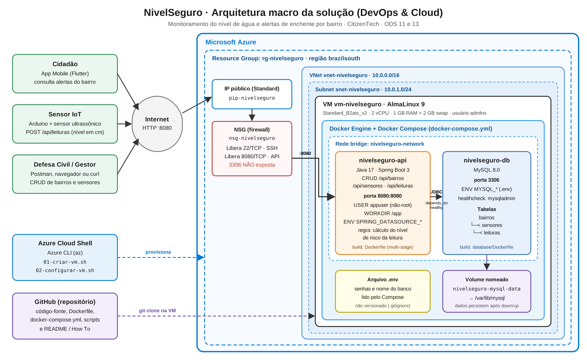
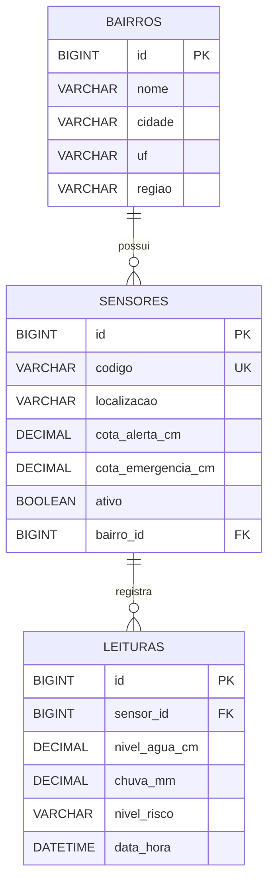

# NívelSeguro 🌊 — Alerta de enchentes por bairro

> **Global Solution 2026/2 · FIAP · CitizenTech**
> Disciplina: **DevOps Tools & Cloud Computing**
> API Java (Spring Boot) + MySQL executando em **containers Docker** numa **VM Linux no Microsoft Azure**, provisionada por **Azure CLI**.

---

## 👥 Integrantes

| Nome completo | RM | Turma |
|---|---|---|
| _Lucas Martinez_ | _RM553816_ | _2TDS_ |


**🎥 Vídeo de demonstração (YouTube, não listado):** _cole o link aqui_

---

## 📌 Sumário

1. [Sobre a solução](#-sobre-a-solução)
2. [Arquitetura macro](#-arquitetura-macro)
3. [Tecnologias](#-tecnologias)
4. [Modelo de dados](#-modelo-de-dados-2-tabelas-relacionadas--3-tabelas)
5. [Estrutura de diretórios](#-estrutura-de-diretórios)
6. [How To — passo a passo para reproduzir](#-how-to--passo-a-passo-para-reproduzir-o-ambiente)
7. [Endpoints da API](#-endpoints-da-api)
8. [Testes do CRUD e SELECT no banco](#-testes-do-crud-e-select-no-banco)
9. [Evidências técnicas](#-evidências-técnicas)
10. [Checklist dos requisitos](#-checklist-dos-requisitos-da-disciplina)
11. [Solução de problemas](#-solução-de-problemas)
12. [Limpeza dos recursos](#-limpeza-dos-recursos)
13. [Uso de IA generativa](#-uso-de-ia-generativa)

---

## 💡 Sobre a solução

**Problema.** Enchentes atingem todos os anos bairros próximos a rios e córregos — no Brasil, as inundações de 2024 no Rio Grande do Sul e as cheias recorrentes na várzea do Rio Tietê, em São Paulo, mostram como a falta de **aviso antecipado** coloca vidas e bens em risco. Muitas vezes o morador só percebe a cheia quando a água já está na porta.

**Cidadão beneficiado.** Moradores de áreas de risco de alagamento (frequentemente comunidades periféricas), e a Defesa Civil local, que precisa de dados em tempo real para agir.

**Como funciona.**
1. Um **sensor IoT** (Arduino + sensor ultrassônico) instalado na margem do rio mede a altura da água e envia a leitura para a API (`POST /api/leituras`).
2. A **API NívelSeguro** compara o nível com as cotas cadastradas do sensor e classifica o risco automaticamente: `NORMAL`, `ATENCAO` (≥ 70% da cota de alerta), `ALERTA` ou `EMERGENCIA`.
3. O **app mobile** consulta os alertas ativos (`GET /api/leituras/alertas`) e avisa o cidadão do bairro.
4. A **Defesa Civil** cadastra bairros e sensores e acompanha o histórico de leituras.

**ODS da ONU atendidos**
- **ODS 11 — Cidades e comunidades sustentáveis:** reduz o impacto de desastres sobre a população urbana (meta 11.5).
- **ODS 13 — Ação contra a mudança global do clima:** fortalece a capacidade de adaptação a eventos climáticos extremos (meta 13.1).

---

## 🏗 Arquitetura macro



**Fluxo de uma requisição:**
`Sensor/App/Postman` → Internet → **IP público** da VM → **NSG** (libera apenas 22 e 8080) → VM AlmaLinux 9 → Docker → container **nivelseguro-api** (porta 8080) → JDBC pela rede **nivelseguro-network** → container **nivelseguro-db** (MySQL, porta 3306) → dados gravados no **volume nomeado** `nivelseguro-mysql-data`.

| Componente | Nome | Detalhe |
|---|---|---|
| Resource Group | `rg-nivelseguro` | região `brazilsouth` |
| VNet / Subnet | `vnet-nivelseguro` / `snet-nivelseguro` | 10.0.0.0/16 / 10.0.1.0/24 |
| NSG | `nsg-nivelseguro` | entrada: 22 (SSH) e 8080 (API). A 3306 **não** é exposta à internet |
| IP público | `pip-nivelseguro` | SKU Standard |
| VM | `vm-nivelseguro` | AlmaLinux 9 · Standard_B2ats_v2 · 2 GB de swap |
| Container 1 | `nivelseguro-api` | Java 17 + Spring Boot 3 · usuário `appuser` (não-root) |
| Container 2 | `nivelseguro-db` | MySQL 8.0 · volume `nivelseguro-mysql-data` |
| Rede Docker | `nivelseguro-network` | bridge |

---

## 🧰 Tecnologias

| Camada | Tecnologia |
|---|---|
| Nuvem | Microsoft Azure (VM Linux, VNet, NSG, IP público) |
| Provisionamento | Azure CLI (Azure Cloud Shell) |
| Sistema operacional | AlmaLinux 9 |
| Containers | Docker Engine, Dockerfile (multi-stage), Docker Compose |
| Aplicação | Java 17, Spring Boot 3.3 (Web, Data JPA, Validation, Actuator) |
| Banco de dados | MySQL 8.0 em container |

---

## 🗃 Modelo de dados (2 tabelas relacionadas → 3 tabelas)



- `bairros 1 : N sensores` (FK `sensores.bairro_id`)
- `sensores 1 : N leituras` (FK `leituras.sensor_id`)
- As tabelas e uma carga inicial de dados são criadas pelo [`database/init.sql`](database/init.sql), executado automaticamente pelo MySQL na primeira subida do container.

---

## 📁 Estrutura de diretórios

```
nivelseguro/
├── Dockerfile                  # imagem da API (multi-stage, WORKDIR, USER não-root, ENV, EXPOSE)
├── docker-compose.yml          # app + banco + network + volume + portas + env + depends_on
├── .env.example                # modelo das variáveis de ambiente (copiar para .env)
├── .dockerignore
├── .gitignore
├── pom.xml
├── database/
│   ├── Dockerfile              # imagem do banco (MySQL 8.0 + init.sql)
│   ├── init.sql                # criação das 3 tabelas + carga inicial
│   └── consultas.sql           # SELECTs para evidenciar os dados no banco
├── docs/
│   ├── arquitetura.png / .svg  # arquitetura macro
│   ├── roteiro-video.md        # roteiro do vídeo de demonstração
│   └── postman/NivelSeguro.postman_collection.json
├── scripts/
│   ├── azure/
│   │   ├── 01-criar-vm.sh          # Azure CLI: RG, VNet, NSG, IP, VM
│   │   ├── 02-configurar-vm.sh     # Azure CLI: git, swap, Docker e Compose na VM
│   │   └── 99-excluir-recursos.sh  # Azure CLI: remove tudo
│   └── vm/
│       ├── subir-ambiente.sh       # docker compose up -d --build + espera a API
│       ├── testar-crud.sh          # CRUD completo com curl + SELECT no banco
│       └── evidencias.sh           # containers, logs, exec, usuário, volume, rede, SELECT
└── src/main/java/br/com/fiap/nivelseguro/
    ├── controller/   ├── service/   ├── repository/
    ├── model/        ├── dto/       └── exception/
```

---

## 🚀 How To — passo a passo para reproduzir o ambiente

> **Pré-requisito:** uma assinatura do Azure (ex.: Azure for Students). Todos os comandos abaixo foram pensados para o **Azure Cloud Shell (Bash)**, que já tem o Azure CLI instalado e autenticado. Não é preciso instalar nada no computador.

### Passo 1 — Abrir o Cloud Shell e clonar o repositório

1. Acesse **https://shell.azure.com** e escolha **Bash**.
2. Clone o repositório e entre na pasta:

```bash
git clone https://github.com/lucasmartilopes/nivelseguro.git
cd nivelseguro
chmod +x scripts/azure/*.sh scripts/vm/*.sh
```

3. Confira a assinatura ativa:

```bash
az account show --query "{Assinatura:name, Id:id}" -o table
```

### Passo 2 — Provisionar a VM com Azure CLI

```bash
./scripts/azure/01-criar-vm.sh
```

O script pede a **senha do usuário `admlnx`** (mínimo de 12 caracteres, com maiúscula, minúscula, número e símbolo) e executa, em ordem:

| # | Comando Azure CLI | O que faz |
|---|---|---|
| 1 | `az group create` | cria o Resource Group `rg-nivelseguro` em `brazilsouth` |
| 2 | `az vm create` | cria a VM AlmaLinux 9 + VNet, Subnet, NSG (com regra SSH), IP público e disco |
| 3 | `az network nsg rule create` | libera a porta **8080** (API) no NSG |
| 4 | `az vm auto-shutdown` | desliga a VM automaticamente à 01:00 (economia de créditos) |

No final, o script mostra o **IP público** da VM. Anote-o.

<details>
<summary>📄 Comandos Azure CLI utilizados (versão resumida)</summary>

```bash
az group create --name rg-nivelseguro --location brazilsouth

az vm create \
  --resource-group rg-nivelseguro --name vm-nivelseguro --location brazilsouth \
  --image almalinux:almalinux-x86_64:9-gen2:latest --size Standard_B2ats_v2 \
  --authentication-type password --admin-username admlnx --admin-password '<SENHA>' \
  --vnet-name vnet-nivelseguro --vnet-address-prefix 10.0.0.0/16 \
  --subnet snet-nivelseguro --subnet-address-prefix 10.0.1.0/24 \
  --nsg nsg-nivelseguro --nsg-rule SSH \
  --public-ip-address pip-nivelseguro --public-ip-sku Standard \
  --storage-sku Premium_LRS --os-disk-size-gb 64

az network nsg rule create \
  --resource-group rg-nivelseguro --nsg-name nsg-nivelseguro \
  --name Allow-API-NivelSeguro --priority 1010 --direction Inbound \
  --access Allow --protocol Tcp --destination-port-ranges 8080

az vm run-command invoke --resource-group rg-nivelseguro --name vm-nivelseguro \
  --command-id RunShellScript --scripts "<comandos de instalação>"
```
</details>

### Passo 3 — Instalar o Docker na VM (também via Azure CLI)

```bash
./scripts/azure/02-configurar-vm.sh
```

Usando `az vm run-command invoke`, o script executa dentro da VM:
- atualização do sistema e instalação de `git`, `nano` e `tree`;
- criação de **2 GB de swap** (a VM tem 1 GB de RAM; o build Java + MySQL precisa de folga);
- instalação do **Docker Engine** e do **plugin Docker Compose** (repositório oficial da Docker);
- `systemctl enable --now docker` e inclusão do `admlnx` no grupo `docker`.

> ⏱ Cada etapa leva de 1 a 5 minutos.

### Passo 4 — Acessar a VM por SSH

```bash
ssh admlnx@<IP-PUBLICO-DA-VM>
newgrp docker          # apenas no primeiro acesso: ativa o grupo docker na sessão
docker --version
docker compose version
```

### Passo 5 — Clonar o projeto dentro da VM e criar o `.env`

```bash
git clone https://github.com/lucasmartilopes/nivelseguro.git
cd nivelseguro
chmod +x scripts/vm/*.sh

cp .env.example .env
nano .env              # troque MYSQL_ROOT_PASSWORD e MYSQL_PASSWORD (só letras e números)
```

> 🔐 O `.env` guarda as senhas e **não** é enviado ao GitHub (está no `.gitignore`). O `docker-compose.yml` lê os valores dele.

### Passo 6 — Subir os containers (em segundo plano)

```bash
docker compose up -d --build
```

Ou use o script, que também espera a API ficar pronta:

```bash
./scripts/vm/subir-ambiente.sh
```

O que acontece:
1. O Compose constrói a imagem **nivelseguro-db** (`database/Dockerfile`) e a imagem **nivelseguro-api** (`Dockerfile`, build Maven multi-stage). O primeiro build leva de 5 a 10 minutos.
2. Cria a rede `nivelseguro-network` e o volume `nivelseguro-mysql-data`.
3. Sobe o MySQL. Na primeira vez, o `init.sql` cria as tabelas e a carga inicial.
4. Só quando o **healthcheck** do banco fica `healthy`, a API é iniciada (`depends_on: condition: service_healthy`).

Verifique:

```bash
docker compose ps
```

Saída esperada (resumida):

```
NAME              IMAGE                 STATUS                   PORTS
nivelseguro-api   nivelseguro-api:1.0   Up 1 minute              0.0.0.0:8080->8080/tcp
nivelseguro-db    nivelseguro-db:1.0    Up 2 minutes (healthy)   0.0.0.0:3306->3306/tcp, 33060/tcp
```

### Passo 7 — Acessar a API pela internet

No navegador ou no Postman do **seu computador** (não na VM):

```
http://<IP-PUBLICO-DA-VM>:8080/
http://<IP-PUBLICO-DA-VM>:8080/actuator/health
http://<IP-PUBLICO-DA-VM>:8080/api/bairros
```

Também é possível importar a coleção [`docs/postman/NivelSeguro.postman_collection.json`](docs/postman/NivelSeguro.postman_collection.json) e trocar a variável `baseUrl` pelo IP da VM.

---

## 🔌 Endpoints da API

Base: `http://<IP-DA-VM>:8080`

| Recurso | Método | Rota | Status de sucesso |
|---|---|---|---|
| Bairros | GET | `/api/bairros` | 200 |
| | GET | `/api/bairros/{id}` | 200 (404 se não existir) |
| | GET | `/api/bairros/{id}/sensores` | 200 |
| | POST | `/api/bairros` | 201 (400 se inválido) |
| | PUT | `/api/bairros/{id}` | 200 |
| | DELETE | `/api/bairros/{id}` | 204 (remove também sensores e leituras) |
| Sensores | GET | `/api/sensores` | 200 |
| | GET | `/api/sensores/{id}` | 200 |
| | GET | `/api/sensores/{id}/leituras` | 200 |
| | POST | `/api/sensores` | 201 (409 se o código já existir) |
| | PUT | `/api/sensores/{id}` | 200 |
| | DELETE | `/api/sensores/{id}` | 204 |
| Leituras | GET | `/api/leituras` | 200 |
| | GET | `/api/leituras/alertas` | 200 (somente ALERTA e EMERGENCIA) |
| | GET | `/api/leituras/{id}` | 200 |
| | POST | `/api/leituras` | 201 (risco calculado pela API) |
| | PUT | `/api/leituras/{id}` | 200 (risco recalculado) |
| | DELETE | `/api/leituras/{id}` | 204 |
| Saúde | GET | `/actuator/health` | 200 |

**Exemplos de corpo (JSON):**

```json
// POST /api/bairros
{ "nome": "Jardim Pantanal", "cidade": "São Paulo", "uf": "SP", "regiao": "Zona Leste" }

// POST /api/sensores
{ "codigo": "NS-SP-010", "localizacao": "Margem do rio - ponto 10",
  "cotaAlertaCm": 200, "cotaEmergenciaCm": 280, "bairroId": 1 }

// POST /api/leituras  (enviado pelo sensor IoT)
{ "sensorId": 1, "nivelAguaCm": 262.5, "chuvaMm": 40.2 }
```

---

## 🧪 Testes do CRUD e SELECT no banco

### Opção A — Script automático (dentro da VM)

```bash
./scripts/vm/testar-crud.sh
```

Ele executa, nas 3 tabelas: **POST → GET → PUT → SELECT no MySQL → erro 400 → erro 404 → DELETE → SELECT**.

Para rodar a partir do seu computador, contra o IP público:

```bash
./scripts/vm/testar-crud.sh http://<IP-PUBLICO-DA-VM>:8080
```

### Opção B — Comandos manuais com `curl`

```bash
# CREATE
curl -X POST http://localhost:8080/api/bairros \
  -H "Content-Type: application/json" \
  -d '{"nome":"Vila Esperança","cidade":"São Paulo","uf":"SP","regiao":"Zona Leste"}'

curl -X POST http://localhost:8080/api/sensores \
  -H "Content-Type: application/json" \
  -d '{"codigo":"NS-SP-010","localizacao":"Córrego - ponto 10","cotaAlertaCm":200,"cotaEmergenciaCm":280,"bairroId":6}'

curl -X POST http://localhost:8080/api/leituras \
  -H "Content-Type: application/json" \
  -d '{"sensorId":7,"nivelAguaCm":230.5,"chuvaMm":48.2}'

# READ
curl http://localhost:8080/api/bairros
curl http://localhost:8080/api/leituras/alertas

# UPDATE
curl -X PUT http://localhost:8080/api/bairros/6 \
  -H "Content-Type: application/json" \
  -d '{"nome":"Vila Esperança - ALTERADO","cidade":"São Paulo","uf":"SP","regiao":"Zona Leste"}'

# DELETE
curl -X DELETE http://localhost:8080/api/leituras/13
```

> Os ids `6`, `7` e `13` são os próximos após a carga inicial (5 bairros, 6 sensores, 12 leituras). Use os ids retornados pelos POSTs.

### SELECT diretamente no banco

Entrar no cliente MySQL do container:

```bash
docker exec -it nivelseguro-db mysql -u nivelseguro -p nivelseguro
# senha = MYSQL_PASSWORD do arquivo .env
```

```sql
SHOW TABLES;
SELECT * FROM bairros;
SELECT * FROM sensores;
SELECT * FROM leituras ORDER BY id DESC;
SELECT b.nome AS bairro, s.codigo AS sensor, l.nivel_agua_cm, l.nivel_risco, l.data_hora
  FROM leituras l
  JOIN sensores s ON s.id = l.sensor_id
  JOIN bairros  b ON b.id = s.bairro_id
 ORDER BY l.data_hora DESC;
exit
```

Ou executar todas as consultas de uma vez, sem digitar a senha:

```bash
docker exec -i nivelseguro-db sh -c 'mysql -u"$MYSQL_USER" -p"$MYSQL_PASSWORD" "$MYSQL_DATABASE" -t' < database/consultas.sql
```

### Prova de persistência (volume nomeado)

```bash
# 1. Cria um registro
curl -X POST http://localhost:8080/api/bairros -H "Content-Type: application/json" \
  -d '{"nome":"Teste Persistencia","cidade":"São Paulo","uf":"SP"}'

# 2. Remove os containers (sem -v: o volume é mantido)
docker compose down
docker ps -a            # nenhum container nivelseguro
docker volume ls        # o volume nivelseguro-mysql-data continua existindo

# 3. Sobe novamente e confere que o registro continua lá
docker compose up -d
docker exec -i nivelseguro-db sh -c 'mysql -u"$MYSQL_USER" -p"$MYSQL_PASSWORD" "$MYSQL_DATABASE" -t -e "SELECT * FROM bairros WHERE nome LIKE \"Teste%\";"'
```

---

## 🔍 Evidências técnicas

Execute dentro da VM para mostrar tudo de uma vez:

```bash
./scripts/vm/evidencias.sh
```

| Evidência pedida | Comando |
|---|---|
| Containers executando | `docker compose ps` / `docker ps` |
| Logs | `docker compose logs` · `docker logs nivelseguro-api` · `docker logs nivelseguro-db` · `docker logs -f nivelseguro-api` |
| Acesso aos containers | `docker exec -it nivelseguro-api sh` · `docker exec -it nivelseguro-db bash` |
| Usuário utilizado (não-root) | `docker exec nivelseguro-api whoami` → `appuser` · `docker inspect nivelseguro-api --format '{{.Config.User}}'` |
| WORKDIR | `docker exec nivelseguro-api pwd` → `/app` |
| Variáveis de ambiente | `docker exec nivelseguro-api env \| grep SPRING_DATASOURCE_URL` |
| Estrutura de diretórios | `tree -L 2` (projeto) · `docker exec nivelseguro-api ls -la /app` |
| Volume nomeado | `docker volume ls` · `docker volume inspect nivelseguro-mysql-data` |
| Rede | `docker network ls` · `docker network inspect nivelseguro-network` |
| SELECT no banco | ver a seção [SELECT diretamente no banco](#select-diretamente-no-banco) |
| Configuração final do Compose | `docker compose config` |

---

## ✅ Checklist dos requisitos da disciplina

| Requisito | Onde está |
|---|---|
| VM no Azure provisionada por **Azure CLI**, comandos documentados | `scripts/azure/01-criar-vm.sh`, `02-configurar-vm.sh` e [Passo 2](#passo-2--provisionar-a-vm-com-azure-cli) |
| Docker, Dockerfile e Docker Compose dentro da VM | `02-configurar-vm.sh`, `Dockerfile`, `database/Dockerfile`, `docker-compose.yml` |
| App Java em container com **CRUD completo** | `src/` + `/api/bairros`, `/api/sensores`, `/api/leituras` |
| Pelo menos **duas tabelas relacionadas** | 3 tabelas: `bairros 1:N sensores 1:N leituras` (`database/init.sql`) |
| App: **usuário não privilegiado** | `Dockerfile` → `useradd appuser` + `USER appuser` |
| App: **WORKDIR** | `Dockerfile` → `WORKDIR /app` |
| App: **variável de ambiente** | `Dockerfile` → `ENV ...`; Compose → `SPRING_DATASOURCE_*`, `JAVA_OPTS` |
| App: **expor a porta** | `Dockerfile` → `EXPOSE 8080`; Compose → `8080:8080` |
| Banco: **volume nomeado** | `nivelseguro-mysql-data:/var/lib/mysql` |
| Banco: **variável de ambiente** | `MYSQL_ROOT_PASSWORD`, `MYSQL_DATABASE`, `MYSQL_USER`, `MYSQL_PASSWORD` |
| Banco: **porta** | `EXPOSE 3306` + `3306:3306` (bloqueada para a internet pelo NSG) |
| Compose: app, banco, network, volume, portas, env, dependências | `docker-compose.yml` (`depends_on` com `service_healthy`) |
| Containers em **background** | `docker compose up -d --build` |
| Arquitetura macro | `docs/arquitetura.png` |
| Evidências: logs, exec, usuário, diretórios, CRUD, persistência, SELECT | `scripts/vm/evidencias.sh`, `scripts/vm/testar-crud.sh` e seção de evidências |

---

## 🛠 Solução de problemas

| Problema | Solução |
|---|---|
| `az vm create` falha com `SkuNotAvailable` | Troque `SIZE` em `01-criar-vm.sh` por `Standard_B2s` ou `Standard_B1ms` |
| Erro de política/região (`RequestDisallowedByAzure`) | Troque `LOCATION` para `eastus` ou `eastus2` nos scripts 01, 02 e 99 (mesmo nome de RG) |
| `permission denied ... docker.sock` | Execute `newgrp docker` ou saia e entre de novo no SSH |
| `required variable MYSQL_PASSWORD is missing` | Faltou criar o `.env`: `cp .env.example .env` |
| API reiniciando (`Restarting`) | Veja `docker compose logs nivelseguro-api`. Ela só conecta quando o banco está `healthy`. Aguarde e confira `docker compose ps` |
| Build lento ou `Killed` durante o Maven | Confira o swap com `free -m` (deve haver ~2 GB). Rode de novo `docker compose up -d --build` |
| Trocou a senha no `.env` depois da 1ª subida e a API não conecta | O MySQL só lê as variáveis na criação do volume. Recrie com `docker compose down -v` e `docker compose up -d --build` (**apaga os dados**) |
| Não acessa `http://IP:8080` pelo navegador | Confira a regra do NSG: `az network nsg rule list -g rg-nivelseguro --nsg-name nsg-nivelseguro -o table` |
| VM desligou sozinha | É o auto-shutdown da 01:00. Ligue com `az vm start -g rg-nivelseguro -n vm-nivelseguro`. Os containers sobem sozinhos (`restart: unless-stopped`) |

---

## 🧹 Limpeza dos recursos

Dentro da VM:

```bash
docker compose down        # para e remove os containers (mantém o volume)
docker compose down -v     # remove também o volume (APAGA os dados)
```

No Cloud Shell (depois da correção):

```bash
./scripts/azure/99-excluir-recursos.sh
```

---

## 🤖 Uso de IA generativa

Conforme as regras da Global Solution, declaramos o uso de IA generativa:

| Ferramenta | Para quê |
|---|---|
| Claude (Anthropic) | Apoio na estruturação dos scripts Azure CLI, Dockerfile e docker-compose.yml, revisão do código da API, redação do README e do diagrama de arquitetura |

Todo o conteúdo foi revisado, executado e testado pelo grupo na VM do Azure, e todos os integrantes sabem explicar cada arquivo.
